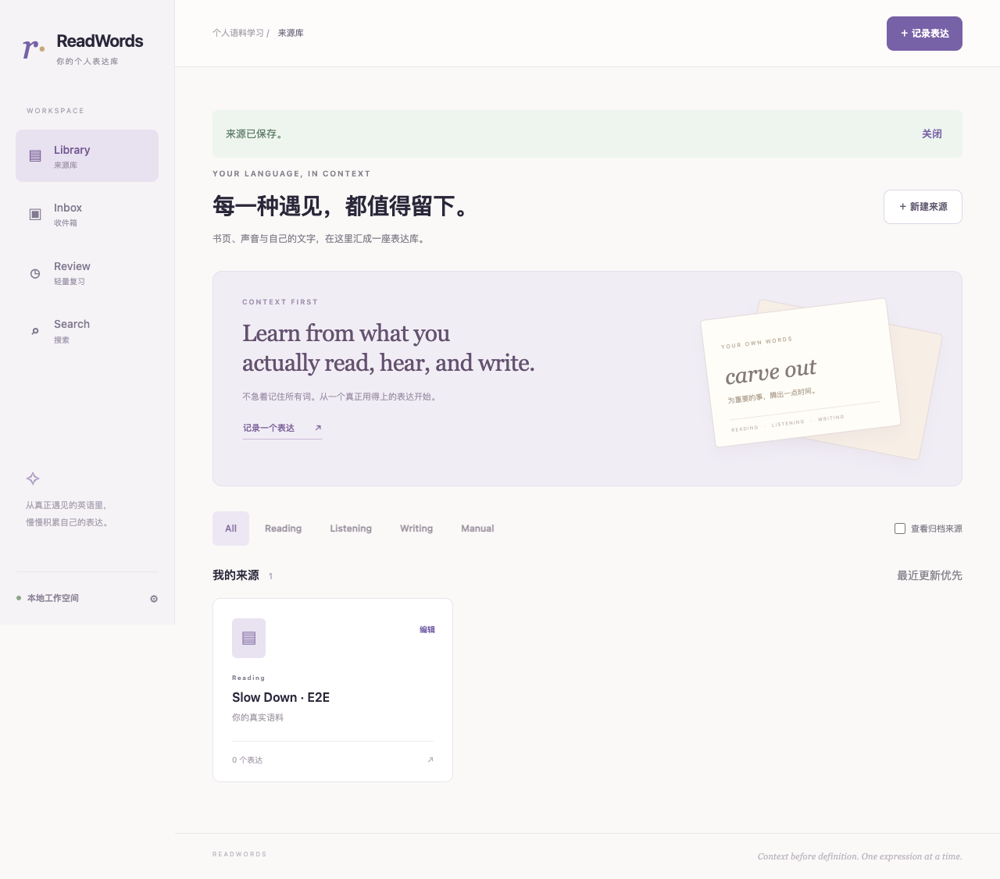
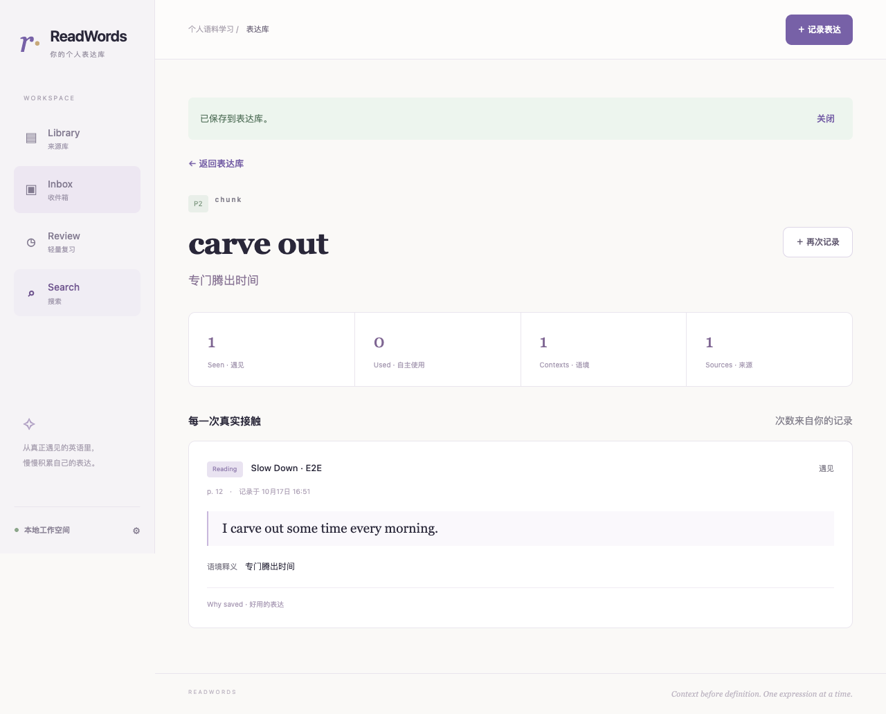

# 首个闭环实现与验收记录

日期：2026-10-17；需求依据：PRD v0.2。  
交付范围：Mac 本地 **Source → 手动采集 → Inbox → 保存 → 搜索详情**。此记录仅表示本阶段结果，不代表完整 R0 发布验收通过。

## 1. 已实现

- 四类来源创建、字段校验、元信息编辑、类型筛选、归档/恢复和来源下表达列表。
- 全局快速采集，允许只留 term；可在采集中内联创建来源。
- Inbox 持久化草稿、串行自动保存、版本冲突提示、失败保留输入、复制与重试、忽略及恢复。
- 正式入库时校验义项、来源、事件、理由、日期、写作纠正与听力时间；原子创建表达/Context 并关联保存结果。
- 精确规范化候选、人工选择义项、保留已有优先级、同形多义和重复事件确认；采集与入库幂等。
- 英文表达、中文释义、来源、原句和改句搜索，来源类型/优先级/来源筛选，结果去重排序。
- 表达详情保留多 Context、真实原文、写作前后内容、位置和理由；Seen、Used、Context、Source 各自计算。
- 本地 SQLite、无外部自动调用、回环监听及同源写入保护；启动/停止及数据定位说明。

## 2. 测试环境

| 项目 | 实际环境 |
|---|---|
| 系统 | macOS 26.6.2，Apple Silicon arm64 |
| Node | v24.18.1 |
| Next.js / React | 16.4.2 / 19.3.1 |
| Tailwind CSS | 4.3.3 |
| Playwright | 1.64.1 |
| 浏览器 | 本机 Google Chrome 155.0.8059.80，headless |
| 窗口 | 1280×800；额外检查 1024px 与 640px 布局宽度 |
| 测试数据 | 自建英文示例；单元测试内存库/临时文件库；E2E 独立临时 SQLite；不使用用户库 |

## 3. 执行结果

| 检查 | 结果 | 证据与限制 |
|---|---|---|
| TypeScript 类型检查 | 通过 | `npm run typecheck`；最终生产构建亦执行 TypeScript 检查 |
| 领域/API 自动测试 | 10/10 通过 | `npm test`，见 tests/store.test.ts |
| Chrome 端到端 | 2/2 通过 | `npm run test:e2e`，最终成功轮耗时约 9.5 秒，见 tests/e2e/workflow.spec.ts |
| 生产构建 | 通过 | `npm run build`，页面静态壳、API 动态路由均构建成功 |
| 本机生产启动 | 通过 | `npm start` 仅监听 127.0.0.1:3000；首页 HTTP 200；来源 API 返回空数组，未注入演示数据 |
| 格式检查 | 通过 | `npm run format:check` |
| 文档引用 | 通过 | README 和 documents 中本地文档、图片链接均可解析 |
| 截图审阅 | 已检查 | 来源页、表达详情，未见遮挡或明显错位；示例数据独立于用户库 |

10 项领域/API 测试覆盖：规范化及日期/位置校验；四类来源和最小草稿落盘后重开；草稿/入库幂等及追加不覆盖；同形多义和重复事件确认；写作纠正不计 Used；注入 SQLite 触发器故障验证事务回滚；版本冲突、忽略恢复与归档来源约束；正式保存字段检查；搜索覆盖和排序；本机 Host/Origin、非 JSON、损坏输入和接口缓存边界。

两条浏览器流程分别验证：

1. 创建 Reading Source → 采集 → Inbox 释义与页码自动保存 → 刷新恢复 → 入库 → 详情原文 → 刷新 → 中文搜索 → 再次打开详情；页面无未处理运行时异常。
2. 采集时内联创建 Writing Source → 纠正事件与前后表达 → 保存 → 详情原证据完整、Used=0 → 1024px/640px 下无整页横向溢出。

### 修复后回归的问题

- Turbopack 的 CSS 编译子进程绑定端口被当前运行环境拒绝；切换 Next.js 官方 Webpack 模式后生产构建成功，dev/build 脚本均固定该模式。
- Next.js 重建 URL 可使用 localhost，浏览器实际访问 127.0.0.1；改为使用严格限制为回环地址的真实 Host 校验 Origin，并添加回归测试，仍拒绝远程 Host 与跨站写入。
- 表单用显式 `htmlFor`/`id` 关联标签，提示采用 `aria-describedby`，避免 select 选项混入标签匹配。
- 表达结果卡增加明确的可访问名称；测试使用业务含义定位，不依赖相邻文字间的渲染空格。

## 4. 与全量验收清单的对应

| PRD 用例 | 本阶段覆盖情况 |
|---|---|
| AT-01 | 领域层覆盖四类来源；浏览器操作覆盖 Reading/Writing；完整 UI 四类型逐项验收尚未执行 |
| AT-03/04 | 覆盖最小草稿、刷新恢复、忽略恢复、幂等和事务失败；磁盘满与离开提示全量操作待后续 |
| AT-05–AT-09 | 领域层覆盖候选、同形多义、重复确认、追加及 Used 区分；删除/恢复/改归属尚未实现 |
| AT-12/13 | 仅支持纯手工流程；AI/复习对应部分尚未实现，不标通过 |
| AT-19 | 覆盖草稿版本冲突；复习跨标签场景尚未实现 |
| AT-21 | 已实现基本字段搜索、筛选、去重和排序；复杂归档及匹配字段定位仍需完整验收 |
| AT-24 | Chrome 桌面布局与可访问标签已验证；Safari、VoiceOver、完整键盘任务及真实浏览器 200% 缩放未执行 |
| NT-04/05/07 | 已覆盖事务注入、幂等、版本冲突、请求边界；不是完整故障/安全测试结论 |
| NT-08 | 文件数据库关闭重开通过；正式迁移快照、JSON 恢复、断外网全链路未验收 |
| 其他 AT/NT | 本阶段未执行；后续按 PRD 继续，不沿用本轮“通过”替代 |

## 5. 未完成项

完整 R0 仍需实现 Review、真实 AI、JSON 备份恢复、表达/Context 编辑与回收站、来源删除，以及容量、性能、Safari/VoiceOver/真实缩放和故障恢复验收。OCR/PWA/CSV/汇总统计仍属 R1。

640px 布局检查是缩放后重排的辅助验证，不能替代实际浏览器缩放或无障碍实机验收。单元测试关闭重开 SQLite 不是完整系统灾难恢复测试。当前搜索使用应用层子串匹配，未验证 10k 表达/50k 语境容量目标。

## 6. 界面证据

下图使用独立 E2E 示例数据，非真实用户内容。

本地启动、数据位置、人工临时备份与 5 分钟操作步骤见 [README](../README.md)。本阶段不部署远程服务、不推送远程 Git 仓库。
